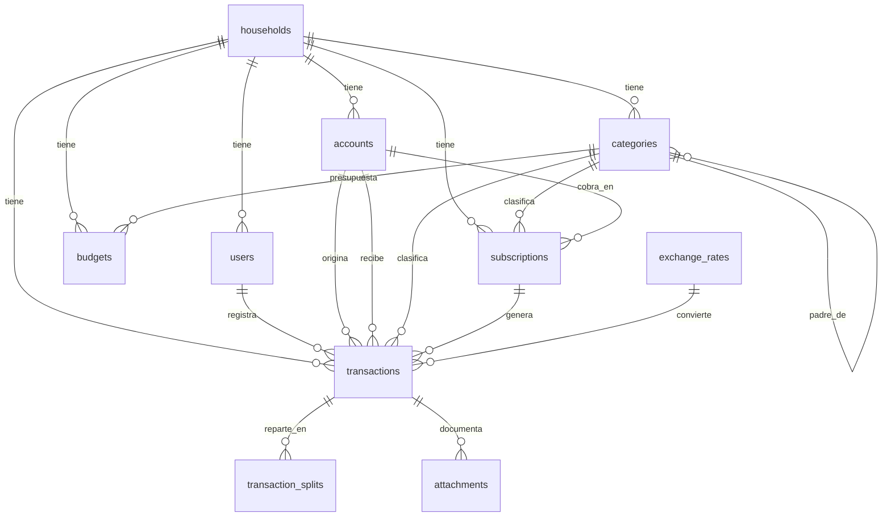

# Modelo entidad-relación — Finanzas personales v1

Motor decidido: PostgreSQL. Modelos con SQLAlchemy, migraciones con Alembic.
Dinero: enteros en unidades menores (`BIGINT`), nunca FLOAT/DOUBLE para el monto principal. Las tasas sí usan `NUMERIC(19,8)`.
Todas las tablas: `id` BIGINT autoincremental, `created_at`, `updated_at`. Borrado lógico donde se indica; las transacciones no se borran, se anulan.

## Diagrama (Mermaid)

## Tablas

### households
- `id`, `name` (ej. Hogar), `base_currency` CHAR(3) default 'USD', `timezone` default 'America/Caracas'
- Nota: v1 tiene un solo hogar. La tabla existe para no reescribir el modelo si después se separa algo, no para abrir multi-tenant a terceros.

### users
- `id`, `household_id` FK → households, `name`, `email` UNIQUE, `password_hash` (Argon2/bcrypt), `role` ENUM('admin','registro'), `last_login_at` nullable
- Índice: `household_id`, `email`. La autenticación es JWT sin estado: no hay tabla de tokens de acceso; los refresh tokens revocables viven en `refresh_tokens` (ver abajo) o se revocan por lista de revocación.

### accounts
- `id`, `household_id` FK, `name` (Efectivo, Cuenta bancaria, billetera, cripto), `type` ENUM('efectivo','banco','paypal','cripto','tarjeta'), `currency` CHAR(3), `opening_balance_minor` BIGINT default 0, `is_main_fund` BOOL default false, `archived_at` nullable
- Único: `household_id + name` (evita dos "Efectivo").
- El saldo NO se guarda: se calcula sumando transacciones. `opening_balance_minor` es el punto de partida.

### categories
- `id`, `household_id` FK, `parent_id` FK nullable → categories.id, `name`, `kind` ENUM('necesario','innecesario'), `is_income_category` BOOL default false, `archived_at` nullable
- Único: `household_id + parent_id + name` (con parent null tratado como grupo propio).
- Semilla: Educación, Supermercado, Consumo, Transferencia, Pago móvil, Hosting, Vehículo, Comisiones, Internet/TV, aporte de otro miembro del hogar (ingreso), Salario (ingreso).

### transactions (núcleo)
- `id`, `household_id` FK, `created_by` FK → users, `type` ENUM('ingreso','gasto','transferencia')
- `date` DATE (fecha real del movimiento), `account_id` FK → accounts, `destination_account_id` FK nullable → accounts (solo transferencias)
- `category_id` FK nullable → categories (null en transferencias)
- `subscription_id` FK nullable → subscriptions (si la generó una suscripción)
- `description` VARCHAR(255), `amount_minor` BIGINT (> 0), `currency` CHAR(3)
- `exchange_rate` DECIMAL(19,8) nullable (tasa guardada en el momento), `base_amount_minor` BIGINT, `base_currency` CHAR(3) default 'USD'
- `status` ENUM('confirmado','por_confirmar','deuda_pendiente','anulado') default 'por_confirmar' en gastos manuales, salvo que se cree ya confirmado
- `due_month` CHAR(7) nullable (YYYY-MM, para deuda_pendiente), `original_month` CHAR(7) nullable (si se movió de mes)
- `receipt_url` VARCHAR(500) nullable, `is_opening_balance` BOOL default false, `void_reason` nullable, `voided_at` nullable
- `dedup_hash` CHAR(64) UNIQUE (solo entre transacciones no anuladas), `idempotency_key` VARCHAR(100) nullable UNIQUE por hogar
- Índices: `household_id + date`, `household_id + status`, `household_id + category_id + date`, `account_id + date`, `destination_account_id`
- Reglas en base y en código: gasto → `destination_account_id` null y `category_id` obligatorio; transferencia → ambos `account_id` y destino obligatorios y `category_id` null; ingreso aporte de otro miembro del hogar → categoría de ingreso, nunca de gasto; `amount_minor` nunca negativo.

### transaction_splits (reparto de facturas compartidas)
- `id`, `transaction_id` FK → transactions (ON DELETE CASCADE), `fund` VARCHAR(50) (FONDO_PRINCIPAL, FUND_CONTRIBUTOR u otro fondo definido), `amount_minor` BIGINT (> 0)
- Regla: la suma de splits de una transacción debe ser igual a `transactions.amount_minor`. Si no hay splits, el 100% es FONDO_PRINCIPAL por defecto (implícito, no fila).
- Índice: `transaction_id`.

### budgets
- `id`, `household_id` FK, `category_id` FK → categories, `month` CHAR(7) (YYYY-MM), `amount_minor` BIGINT, `currency` CHAR(3)
- Único: `household_id + month + category_id`. Índice: `household_id + month`.

### subscriptions
- `id`, `household_id` FK, `account_id` FK → accounts, `category_id` FK → categories, `name`, `amount_minor` BIGINT, `currency` CHAR(3), `charge_day` TINYINT (1-31), `status` ENUM('activa','pausada','cancelada') default 'activa', `last_generated_month` CHAR(7) nullable
- Al generar, se crea una `transaction` con `subscription_id` y estado `por_confirmar`.

### exchange_rates
- `id`, `from_currency` CHAR(3), `to_currency` CHAR(3), `rate` DECIMAL(19,8), `date` DATE, `source` VARCHAR(255)
- Único: `from_currency + to_currency + date + source`. Índice: `from_currency + to_currency + date`.

### attachments (reservada para v1.1, no se expone en v1 salvo receipt_url)
- `id`, `transaction_id` FK → transactions, `type` ENUM('link','file'), `url_or_path` VARCHAR(500), `label` nullable
- En v1 solo se usa `transactions.receipt_url`. Esta tabla queda definida para no migrar el modelo cuando actives subida de archivos.

### imports
- `id`, `household_id` FK, `created_by` FK → users, `source` ENUM('previous_system','spreadsheet'), `mode` ENUM('dry_run','commit'), `cutoff_date` DATE nullable, `summary_json` JSON (totales origen, totales destino, duplicados, errores), `status` ENUM('ok','con_diferencias','fallido')
- Sirve como constancia de la migración: sin un `commit` con totales cuadrados, no hay corte.

### refresh_tokens (revocación de sesiones)
- `id`, `user_id` FK → users, `token_hash` CHAR(64) UNIQUE (nunca se guarda el token en claro), `expires_at`, `revoked_at` nullable, `created_at`
- Al cerrar sesión o rotar, se marca `revoked_at`. Índice: `user_id`, `token_hash`.

### audit_logs (trazabilidad mínima)
- `id`, `household_id` FK, `user_id` FK → users, `entity_type`, `entity_id`, `action` (create, update, confirm, move_month, void), `changes_json` JSON, `created_at`
- Se registra toda corrección de monto/cuenta y toda anulación. No se usa para reconstruir saldos: los saldos salen de `transactions`.

## Mapeo de migración (sistema anterior → este modelo)

| Origen | Destino |
|---|---|
| sistema anterior asset account (Efectivo, etc.) | `accounts` |
| sistema anterior expense account / detalle de la hoja de cálculo | descripción + `category_id` |
| sistema anterior category / categoría de la hoja de cálculo | `categories` (deduplicar por nombre) |
| sistema anterior withdrawal / gasto de la hoja de cálculo | `transactions` tipo gasto |
| sistema anterior deposit salario / saldo inicial de la hoja de cálculo | `transactions` tipo ingreso, `is_opening_balance=true` |
| Aporte de otro miembro del hogar | `transactions` tipo ingreso, categoría aporte de otro miembro del hogar |
| estado POR CONFIRMAR de la hoja de cálculo | `status='por_confirmar'` |
| DEUDAS de la hoja de cálculo (mes siguiente) | `status='deuda_pendiente'`, `due_month` = mes destino |
| pestaña mensual de la hoja de cálculo | `budgets` (si hay presupuesto) + filtro `month` en informes |
| reparto de fondos de la hoja de cálculo | `transaction_splits` |

## Decisiones de modelo que debes validar

1. ¿Te basta con un solo hogar y roles admin/registro, o quieres solo un usuario en v1?
2. ¿El reparto FUND_MAIN / FUND_CONTRIBUTOR como `splits` representa el caso, o se prefieren cuentas separadas para cada fondo?
3. ¿Anular en vez de borrar es aceptable para no perder historia?
